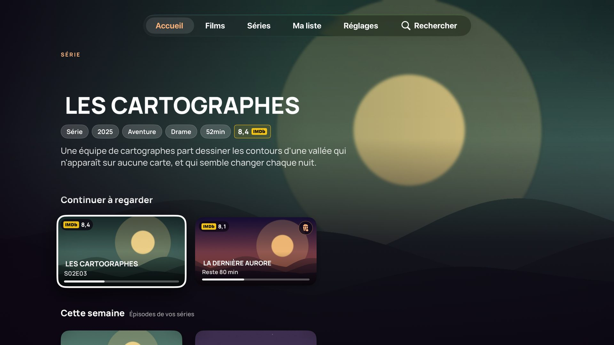
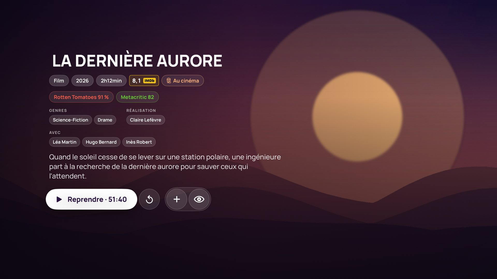
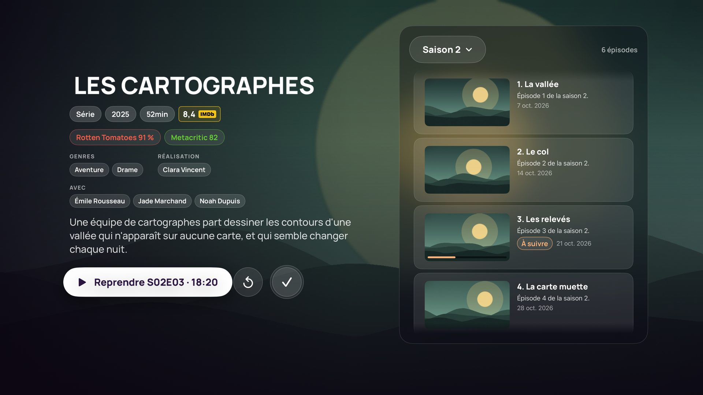
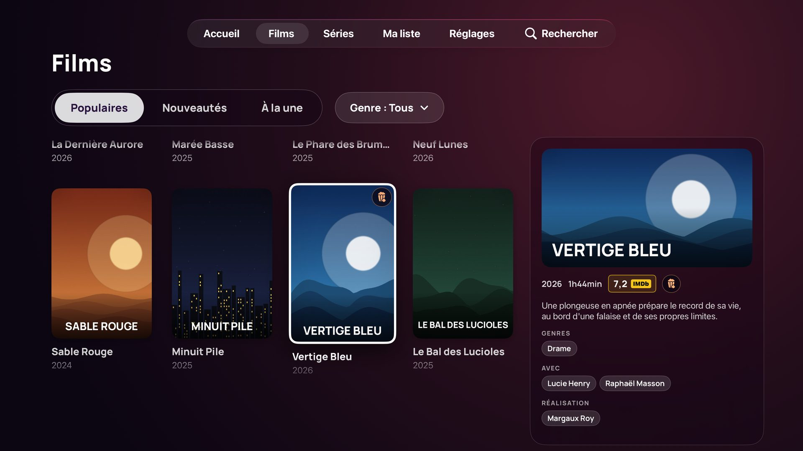
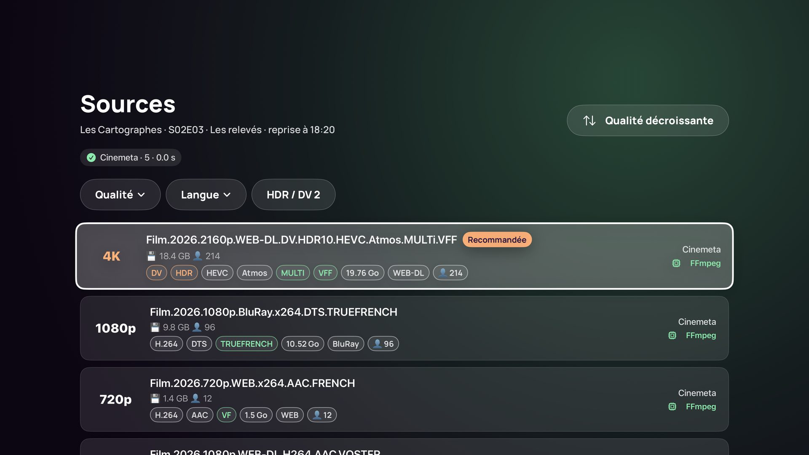
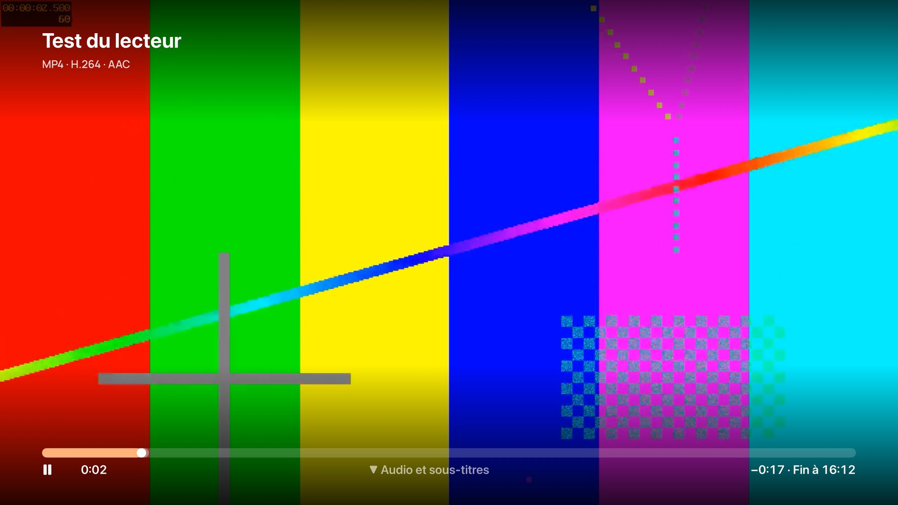
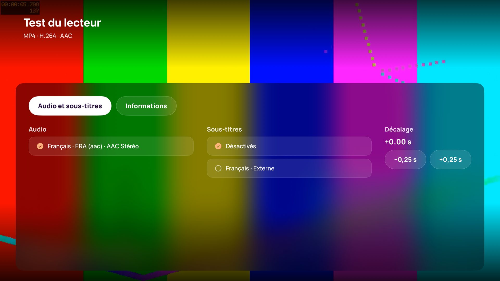

# Aurora

**Client Stremio natif pour Apple TV**, en français, pensé pour la Siri Remote.
Vos addons Stremio, votre compte et votre bibliothèque, un vrai lecteur pour les MKV, le HEVC,
le HDR et le DTS, des bandes-annonces en fond et un carrousel sur l'écran d'accueil de
l'Apple TV.



<sub>Captures prises automatiquement sur le simulateur Apple TV en mode démonstration : les
films et séries sont inventés, leurs images générées.</sub>

> Aurora n'héberge, ne fournit ni ne recommande aucun contenu : elle affiche ce que renvoient
> les addons que vous installez. Elle n'embarque aucun moteur torrent.

## Ce qu'elle fait

| | |
|---|---|
|  |  |
| **Fiches** : notes IMDb, Rotten Tomatoes et Metacritic, genres, distribution, bande-annonce, reprise | **Séries** : épisodes dans un panneau à droite, saison en menu, « À suivre » |
|  |  |
| **Films / Séries** : Populaires, Nouveautés, À la une, et un panneau de détails qui suit la sélection | **Sources** : tri intelligent (VF, 4K, compatibilité), filtres à compteurs, source recommandée |
|  |  |
| **Lecteur** : heure de fin, défilement accéléré, passer l'intro, épisode suivant | **Audio et sous-titres** : français par défaut, sous-titres auto en VO, décalage |

- **Compte Stremio** (connexion par code QR) : addons, bibliothèque et progression synchronisés
  avec les autres apps Stremio.
- **Accueil** : bandeau avec bande-annonce muette qui défile tout seul, « Continuer à
  regarder », « Cette semaine » (épisodes de vos séries), « Ma liste », catalogues de vos addons.
- **Lecteur AetherEngine** (FFmpeg + chemin d'affichage d'Apple) : MKV, HEVC 10 bits, HDR10 et
  Dolby Vision, DTS et TrueHD, sous-titres SRT/ASS/PGS ; repli sur le lecteur système.
- **Télécommande** : sauts, défilement accéléré en maintenant gauche/droite, touches ⏪/⏩ des
  télécommandes de TV, Menu qui revient en arrière sans quitter le film.
- **Passer l'intro** (TheIntroDB, AniSkip pour les animés) et encart d'épisode suivant au début
  du générique.
- **Bandes-annonces** via un petit service sur votre NAS : en fond sur les fiches, en plein écran
  avec le son, et dans le **carrousel Top Shelf** de l'écran d'accueil de l'Apple TV.
- **Titres lisibles** pour les films asiatiques ou russes (titre français via Wikidata), films
  déjà vus estompés ou masqués, pastilles « Au cinéma » et « Nouvel épisode ».

## Installer

1. Télécharger le dernier IPA : [Releases](https://github.com/popolski/lanterne-tv/releases)
   (`build-NN`, fichier `Lanterne-…-unsigned.ipa`).
2. L'installer sur l'Apple TV avec [atvloadly](https://github.com/bitxeno/atvloadly) et un
   compte Apple (gratuit suffit), **« Remove extensions » désactivé**.
3. Pour une mise à jour : **ouvrir d'abord une autre app sur l'Apple TV**, puis installer
   par-dessus (les réglages et la bibliothèque sont conservés).
4. Facultatif : installer le service de bandes-annonces sur le NAS
   ([trailer-server/](trailer-server/README.md)).

Pas à pas complet : **[Guide d'utilisation](docs/GUIDE.md)**.

## Documentation

| Document | Contenu |
|---|---|
| [Guide d'utilisation](docs/GUIDE.md) | installation, chaque écran, la télécommande, chaque réglage, dépannage |
| [Pile technique et choix](docs/TECHNICAL.md) | technologies, architecture, décisions et leurs raisons, leçons tirées de l'appareil |
| [Moteur de lecture](docs/PLAYER-ENGINE.md) | comparaison AVPlayer / VLC / mpv / KSPlayer / AetherEngine, jalons, formats, mise en œuvre |
| [Architecture du code](docs/ARCHITECTURE.md) | modules, focus, cycle de vie du lecteur, persistance |
| [État du projet](docs/STATUS.md) | implémenté / compilé / testé / validé sur l'Apple TV, fonction par fonction |
| [Déploiement](docs/DEPLOYMENT.md) | CI GitHub Actions, IPA, atvloadly, mises à jour, blocages connus |
| [API Stremio](docs/STREMIO-API.md) | protocole des addons, API de compte non officielle, risques |
| [Sécurité](docs/SECURITY.md) | secrets, journaux, ATS, données non fiables, services tiers |
| [Qualification sur l'appareil](docs/QA-DEVICE-CHECKLIST.md) | procédure de test sur l'Apple TV |
| [Feuille de route](docs/ROADMAP.md) | historique, idées en attente |
| [Service de bandes-annonces](trailer-server/README.md) | installation Docker sur le NAS, mise à jour de yt-dlp |

## Pour les développeurs

Aucun Mac n'est nécessaire : tout est compilé par GitHub Actions (image `xcode-27`).

```bash
cd Packages/LanterneCore && swift test   # logique métier (121 tests)
```

```bash
cd trailer-server && python3 -m unittest -v test_server test_topshelf   # service NAS
```

Avec un Mac : `brew install xcodegen`, puis `xcodegen generate` et ouvrir `Lanterne.xcodeproj`.

```
App/
  Sources/        App, Design, Home, Discover, Search, Detail, Sources, Library, Settings, Player, Platform
  TopShelf/       extension du carrousel de l'écran d'accueil
  Resources/      icônes en couches, polices (Manrope), clips de test
  UITests/        tests d'interface et captures d'écran (mode démo)
Packages/LanterneCore/   logique métier testable (SwiftPM, sans interface)
trailer-server/          service NAS : bandes-annonces, extraits, images du carrousel (Python, Docker)
scripts/                 IPA (empaquetage, pseudo-signature, vérification), icônes, images de démo, journaux
docs/                    documentation, captures, images de démo
project.yml              projet XcodeGen
.github/workflows/       CI (build.yml) et captures d'écran (screenshots.yml)
```

Le nom technique reste « Lanterne » (dépôt, module, identifiant `io.github.popolski.lanterne`) :
changer l'identifiant ferait perdre les données à la mise à jour.

## Licences tierces

- **AetherEngine** (LGPL-3.0 avec exception App Store) et **FFmpeg** (LGPL), liés dynamiquement.
- **Manrope** (SIL Open Font License) : police de l'interface et des images du carrousel.
- Service NAS : **yt-dlp** (Unlicense), **ffmpeg**, **Pillow** (licence HPND), installés dans
  l'image Docker.
- Clips de test : mires générées avec FFmpeg ; images de démo : générées par
  `scripts/generate-demo-assets.py`.
