# Guide d'utilisation d'Aurora

Ce guide décrit Aurora écran par écran, de l'installation au dépannage. Les captures sont
prises automatiquement sur le simulateur Apple TV en **mode démonstration** : les films et
séries qu'on y voit sont inventés, leurs images générées.

## Sommaire

1. [Installer Aurora](#1-installer-aurora)
2. [Premier lancement](#2-premier-lancement)
3. [L'accueil](#3-laccueil)
4. [Films et Séries](#4-films-et-séries)
5. [La fiche d'un film](#5-la-fiche-dun-film)
6. [La fiche d'une série](#6-la-fiche-dune-série)
7. [Choisir une source](#7-choisir-une-source)
8. [Le lecteur et la télécommande](#8-le-lecteur-et-la-télécommande)
9. [Ma liste et la recherche](#9-ma-liste-et-la-recherche)
10. [Bandes-annonces et carrousel de l'écran d'accueil](#10-bandes-annonces-et-carrousel-de-lécran-daccueil)
11. [Réglages, un par un](#11-réglages-un-par-un)
12. [Mettre à jour Aurora](#12-mettre-à-jour-aurora)
13. [Dépannage](#13-dépannage)

---

## 1. Installer Aurora

Aurora n'est pas sur l'App Store : on l'installe soi-même sur l'Apple TV, sans Mac, avec
**atvloadly** (installé sur un NAS ou un ordinateur du réseau local).

1. **Télécharger l'IPA** : page [Releases](https://github.com/popolski/aurora-tv/releases),
   dernier `build-NN`, fichier `Aurora-AppleTV-…-unsigned.ipa`.
2. **Apple TV** : activer le mode développeur (Réglages › Confidentialité et sécurité), puis
   l'appairer dans atvloadly (Réglages › Télécommandes et appareils › Appli Remote et appareils).
3. **atvloadly** : choisir l'IPA, un compte Apple (un compte gratuit suffit ; utiliser de
   préférence un compte secondaire), laisser **« Remove extensions » désactivé**, lancer
   l'installation.
4. La page peut rester sur « 100 % » alors que l'installation est terminée : vérifier dans
   Aurora › Réglages › À propos.

> Avec un compte Apple gratuit, la signature dure 7 jours : atvloadly la renouvelle
> automatiquement tant que l'Apple TV est allumée et joignable.

### Mises à jour automatiques (atvloadly 0.6 ou plus récent)

atvloadly sait suivre les Releases GitHub d'une app et installer lui-même chaque nouveau build :
plus besoin de télécharger l'IPA.

1. Dans atvloadly, sur l'app Aurora, ajouter une **source GitHub** : `popolski/aurora-tv`
   (l'adresse complète du dépôt convient aussi).
2. Choisir le fichier **`Aurora-AppleTV-…-unsigned.ipa`** quand atvloadly propose les fichiers
   du dernier build. Il retient ce choix d'après le mot « AppleTV » du nom et l'applique aux
   builds suivants ; le fichier iPad (« iPad » dans le nom) est de toute façon écarté pour une
   Apple TV.
3. Activer la **mise à jour automatique**. atvloadly vérifie toutes les 6 heures (réglable) et
   installe pendant sa fenêtre de rafraîchissement nocturne (3 h – 6 h par défaut), quand
   l'Apple TV est en veille — ce qui évite aussi le blocage à « 100 % » des installations faites
   pendant que le carrousel est affiché. Sans la mise à jour automatique, il envoie seulement
   une notification (si les notifications d'atvloadly sont configurées).

Les libellés exacts de l'interface d'atvloadly peuvent différer : ce fonctionnement est décrit
d'après son code source (version 0.8.2), pas vérifié écran par écran.

Détails techniques : [DEPLOYMENT.md](DEPLOYMENT.md).

## 2. Premier lancement

- **Sans compte**, Aurora fonctionne avec les addons officiels (Cinemeta pour le catalogue,
  OpenSubtitles pour les sous-titres) et une bibliothèque locale.
- **Avec un compte Stremio** (recommandé) : Réglages › Compte Stremio › **Se connecter avec un
  code**. Un code QR s'affiche : on le scanne avec un téléphone connecté à Stremio, et Aurora
  récupère vos addons, votre bibliothèque et votre progression. Ce qui est regardé dans Aurora
  remonte dans les autres apps Stremio, et inversement.
- Pour lire des **torrents**, il faut un serveur de streaming Stremio sur le réseau (par
  exemple en Docker sur le NAS) : Réglages › Lecteur › Serveur de streaming.

## 3. L'accueil

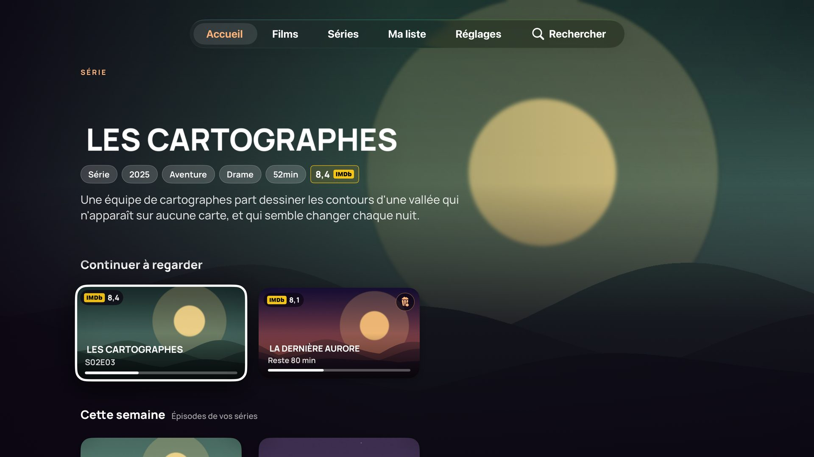

- **Le bandeau** montre le titre sélectionné : image de fond, logo (ou titre), type (« FILM » /
  « SÉRIE »), informations, résumé. Après quelques secondes, sa **bande-annonce** se lance en
  fond, sans le son, si le service du NAS est configuré (voir la section 10).
- **Au repos**, le bandeau passe tout seul au titre suivant de la première rangée ; des petits
  traits en bas à droite montrent où on en est. Dès que vous bougez, il revient au titre
  sélectionné.
- **Les rangées**, de haut en bas :
  - **Continuer à regarder** : titres en cours, avec la progression ;
  - **Cette semaine** : épisodes des séries de votre liste sortis depuis hier ou à paraître
    dans les 7 jours (« S2E5 · Jeudi », « Disponible ») ;
  - **Ma liste** ;
  - puis les catalogues de vos addons (réglables dans Réglages › Accueil).
- **Pastilles** sur les cartes : note IMDb (en haut à gauche), « Nouvel épisode », pop-corn
  pour un film probablement encore au cinéma (sorti depuis moins de 60 jours).

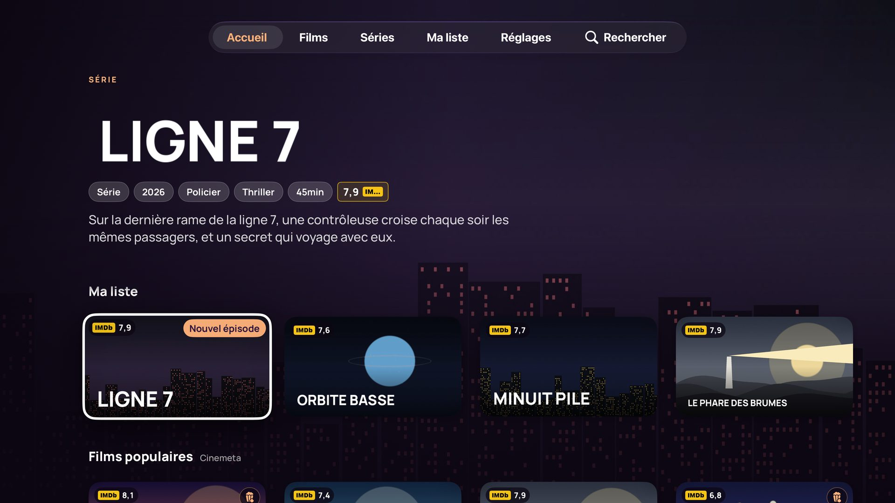

Astuce : appui long sur une carte de « Continuer à regarder » pour la retirer de la rangée.

- **Parce que vous avez regardé…** : rangée de titres proches du dernier film ou de la dernière
  série regardés (recommandations TMDB, via le service du NAS et sa clé TMDB) ; les films déjà
  vus et les titres en cours n'y figurent pas.

## 4. Films et Séries

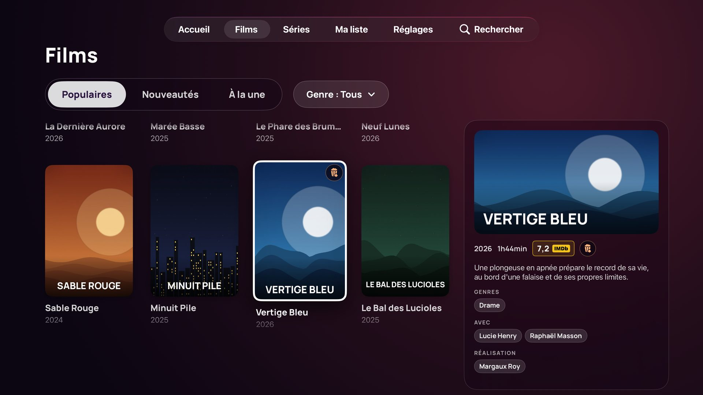

- Trois choix seulement : **Populaires**, **Nouveautés**, **À la une**.
- **Populaires** : menu déroulant « Genre ». **Nouveautés** : menu déroulant « Année ».
- La grille est à gauche ; **le panneau de droite** suit l'affiche sélectionnée : image, logo,
  année, durée, note, résumé, genres, distribution, réalisation.
- Les films déjà vus peuvent être estompés ou masqués (Réglages › Accueil).

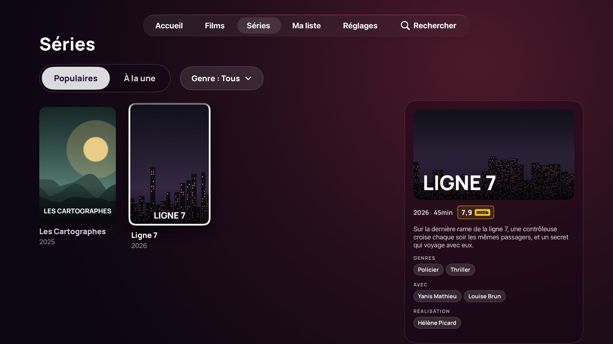

## 5. La fiche d'un film

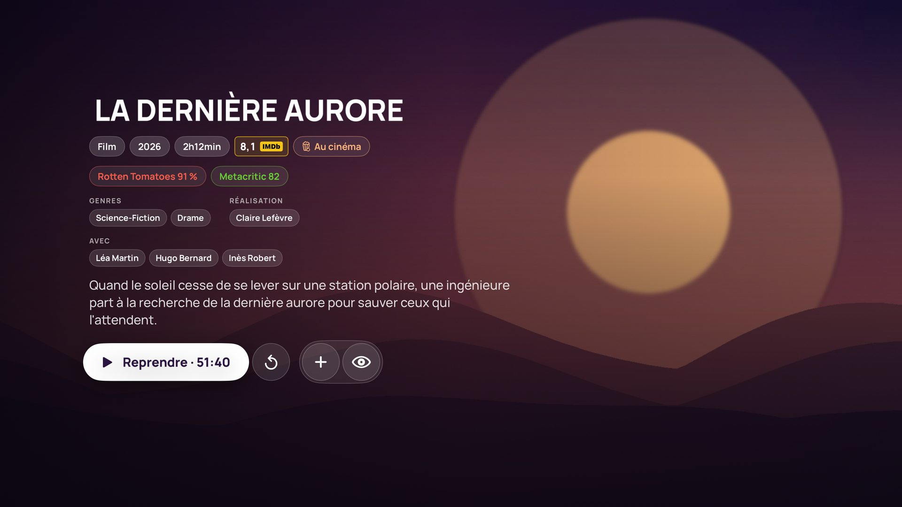

- **Informations** : type, année, durée, note IMDb encadrée, puce « Au cinéma » si le film est
  récent, notes **Rotten Tomatoes** et **Metacritic** (d'après Wikidata, quand elles existent),
  groupes **Genres**, **Réalisation**, **Avec**, résumé.
- **Saga** : si le film fait partie d'une série de films (Wikidata, sinon « collection » TMDB
  via le service du NAS), une rangée « Saga » sous
  les boutons montre toutes les œuvres dans l'ordre (rang de la saga, sinon date), la fiche
  actuelle signalée et les films déjà vus estompés ; flèche vers le bas pour l'atteindre.
- **Filmographie** : depuis les boutons, **flèche vers le haut** pour atteindre les noms de
  **Réalisation** et **Avec** ; un clic ouvre la filmographie de la personne (films puis séries,
  du plus récent au plus ancien, d'après Wikidata). Chaque affiche ouvre la fiche, avec les
  sources de vos addons. La personne est retrouvée parmi la distribution de la fiche d'origine :
  pas de confusion entre homonymes. Disponible pour les fiches avec un identifiant IMDb.
- **Boutons** :
  - **Lire** / **Reprendre · 52:10**, et un bouton rond ↺ pour **reprendre depuis le début**
    s'il y a une reprise ;
  - **Bande-annonce** : plein écran, avec le son (service du NAS nécessaire) ;
  - capsule **Ma liste** (+ / ✓) et **Vu** (œil). Sous les boutons ronds, une légende indique
    le rôle de celui qui a le focus.
- Titres en écriture non latine (japonais, coréen…) : le titre français ou anglais est affiché
  (Wikidata), le titre d'origine en petit dessous ; un logo illisible est remplacé par le titre.

## 6. La fiche d'une série

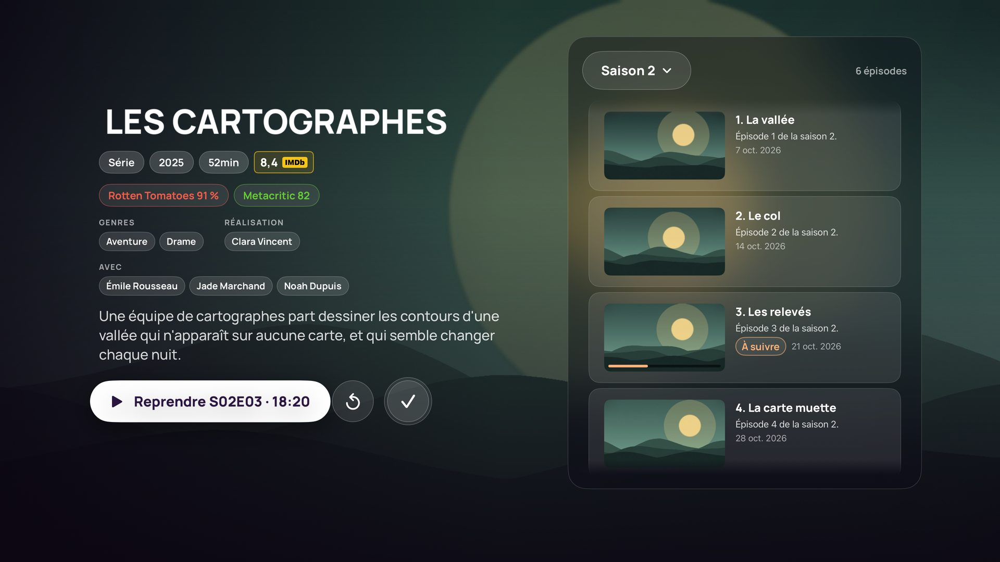

- Les informations à gauche, **les épisodes dans un panneau à droite**, toujours visibles.
- **Saison** : menu déroulant en haut du panneau.
- Chaque épisode : vignette, titre, résumé, date, progression, coche « vu », étiquette
  **À suivre** sur l'épisode que lance le bouton Lire, **À venir** s'il n'est pas sorti.
- Depuis les boutons, **flèche droite** pour entrer dans la liste ; **appui long** sur un
  épisode pour le marquer vu ou non vu.

## 7. Choisir une source

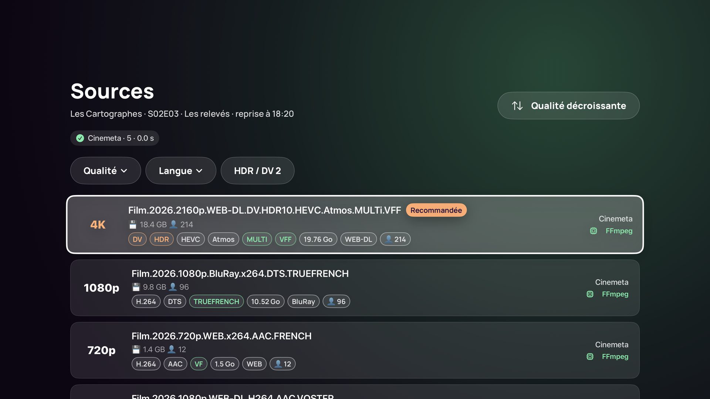

- Aurora interroge tous vos addons de sources en parallèle ; chaque addon affiche son état
  (en cours, nombre de sources et temps de réponse, erreur).
- **Tri** (bouton en haut à droite) : qualité, langue préférée (VF, VOSTFR…), masquage des
  CAM/TS et des sources non lisibles.
- **Filtres** : **Qualité**, **Langue**, **Addon** (avec le nombre de sources par option),
  **HDR / DV**, **Effacer**. Les compteurs tiennent compte des autres filtres.
- Chaque source affiche ce qu'annonce l'addon : résolution, HDR, codec, audio, langues, taille,
  origine, « En cache » (débridage), nombre de pairs ; **Recommandée** sur la meilleure,
  **Déjà utilisée** sur celle choisie la dernière fois ; et une estimation de lisibilité
  (native, moteur FFmpeg, via le serveur de streaming, non lisible).
- Le focus arrive sur la première source : **OK** lance la lecture.
- Option : lancer automatiquement la meilleure source (Réglages › Sources).

## 8. Le lecteur et la télécommande

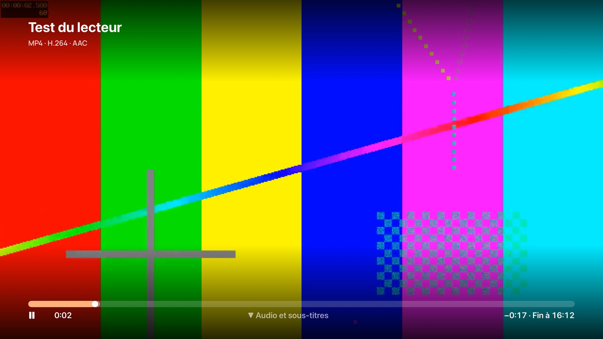

| Action | Siri Remote |
|---|---|
| Lecture / pause | clic au centre, ou touche Lecture/Pause |
| Reculer / avancer (10 s par défaut) | clic à gauche / à droite du pavé |
| Retour / avance rapide qui accélère (×8 → ×128) | **maintenir** gauche / droite ; la lecture reprend au relâchement |
| Se déplacer dans la vidéo | balayer horizontalement, puis cliquer pour valider |
| Passer l'intro, le résumé | **OK** quand le bouton « Passer l'intro » est affiché ; Menu pour regarder |
| Audio, sous-titres, sources, infos | flèche ou balayage **vers le bas** |
| Afficher l'interface | flèche vers le haut |
| Fermer | **Menu** (ferme d'abord le panneau, puis l'interface, puis le lecteur) |
| Annuler la mise en veille | n'importe quelle touche pendant le fondu « Bonne nuit » |

- Les touches **⏪ / ⏩** d'une télécommande de téléviseur (HDMI-CEC) ou de l'iPhone
  fonctionnent aussi (appui simple : saut ; maintenu : défilement accéléré).
- La barre indique le temps restant et **l'heure de fin** (« Fin à 22:47 »).
- **Épisode suivant** : un encart apparaît pendant le générique (au début du générique s'il est
  connu, sinon 60 s avant la fin, réglable), avec un compte à rebours si la lecture
  automatique est activée. Les sources de l'épisode suivant sont **cherchées pendant le
  générique** : l'épisode s'ouvre sans repasser par « Recherche de sources… ».

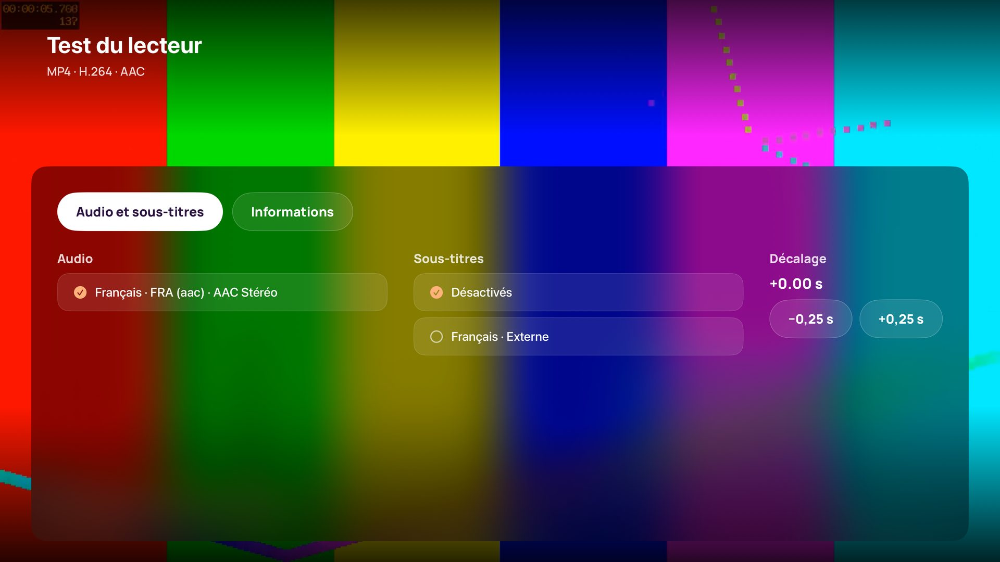

**Pistes mémorisées par série.** Dans une série, choisir une autre piste audio ou d'autres
sous-titres (ou les désactiver) vaut pour les épisodes suivants de cette série : ils
démarrent avec ces choix au lieu des réglages généraux. Les films ne sont pas concernés.

Le panneau du bas comporte quatre onglets :

- **Audio et sous-titres** : piste audio (le français est choisi par défaut, puis l'anglais),
  sous-titres (en VO, les sous-titres français s'activent automatiquement) et décalage des
  sous-titres par pas de 0,25 s ; taille, position et fond se règlent dans Réglages › Langues ;
- **Sources** : passer à une autre source sans quitter le lecteur ;
- **Minuteur** : arrêter la lecture à la fin de l'épisode (ou du film), ou dans 15, 30, 45,
  60 ou 90 minutes ;
- **Informations** : moteur utilisé, caractéristiques détectées, jalons de démarrage.

**Sous-titres décalés : choisir la réplique entendue.** Dans *Audio et sous-titres*, le bouton
**« Choisir la réplique entendue… »** met la lecture en pause et liste les répliques proches
(« il y a 4 s », « à l'écran », « dans 3 s »). Choisissez celle que vous venez d'entendre :
Aurora calcule le décalage pour qu'elle s'affiche à cet instant, referme le panneau et reprend
la lecture. Le décalage reste réglable finement par ±0,25 s et est conservé pour les lectures
suivantes. Disponible avec AetherEngine pour les sous-titres texte (SRT, ASS, WebVTT) ; les
sous-titres en image (PGS) n'ont pas de texte à proposer. Plage : ±30 s.

**Minuteur de mise en veille.** Quand le temps est écoulé (ou au début du générique de fin si
TheIntroDB le connaît, sinon dans les dernières secondes du fichier), l'image s'assombrit
pendant 12 secondes avec « Bonne nuit » : **n'importe quelle touche** annule l'arrêt et le
minuteur. Sinon la lecture s'arrête, la progression est enregistrée et l'Apple TV se met en
veille selon ses propres réglages. Le minuteur reste actif d'un épisode à l'autre ; le temps
restant s'affiche en haut à droite de l'interface.

**« Êtes-vous toujours là ? »** Après 3 épisodes enchaînés automatiquement sans toucher la
télécommande (réglable : 2 à 5, ou jamais), Aurora met en pause au lieu de lancer le suivant et
demande **Continuer à regarder** ou **Arrêter**. Pendant la question, l'Apple TV peut de nouveau
se mettre en veille. Menu referme la question et reste sur l'épisode en cours.

Si une source ne s'affiche pas (aucune image après quelques secondes), Aurora le dit au lieu de
rester sur un écran noir, et propose de réessayer avec le lecteur système.

## 9. Ma liste et la recherche

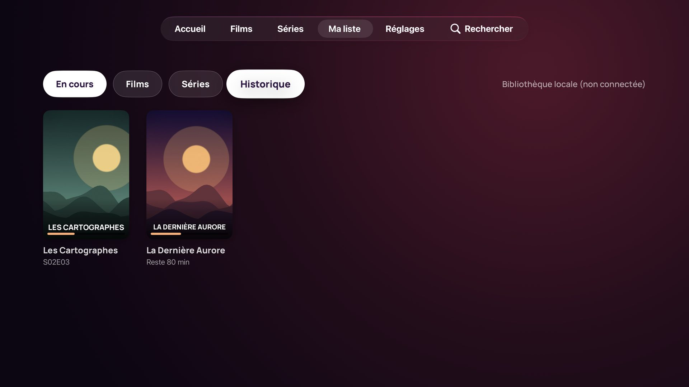

- **Ma liste** : tous les titres ajoutés, synchronisés avec Stremio.
- **Au hasard** (« Je ne sais pas quoi regarder ») : un titre de Ma liste tiré au sort, avec
  son résumé et son image. Filtres : films et séries, films, séries ; durée « peu importe »,
  « moins de 1 h 30 », « moins de 2 h » (pour une série : la durée d'un épisode). Les films déjà
  vus ne sont pas proposés ; **Un autre** relance sans reproposer les précédents ; **Voir la
  fiche** ouvre le titre.
- **Recherche** (loupe dans la barre d'onglets) : saisie au clavier ou dictée Siri ; résultats
  par addon de catalogue. En tête, une rangée **Personnes** (Wikidata) : acteurs, réalisateurs,
  scénaristes dont le nom correspond ; un clic ouvre leur filmographie.

## 10. Bandes-annonces et carrousel de l'écran d'accueil

Les addons ne donnent que des liens YouTube, que l'Apple TV ne sait pas lire dans une app.
Le petit service **aurora-trailers**, installé sur le NAS, prépare les bandes-annonces et les
sert sur le réseau local. Installation : [trailer-server/README.md](../trailer-server/README.md).

Une fois le service installé (Réglages › **Bandes-annonces** › adresse du NAS, puis « Tester la
connexion ») :

- bande-annonce **muette en fond** sur les fiches et dans le bandeau de l'accueil, après un
  délai réglable ;
- bande-annonce **à la demande, avec le son** : bouton « Bande-annonce » de la fiche ;
- **carrousel Top Shelf** : quand Aurora est dans la première rangée de l'écran d'accueil de
  l'Apple TV, le haut de l'écran montre les dix dernières sorties de films, avec leur titre et
  un extrait de 30 s ; « Lire » et « Plus d'infos » ouvrent Aurora.

**Contenu du carrousel.** Réglages › **Carrousel de l'écran d'accueil** : *Dernières sorties*
(par défaut), *Continuer à regarder* (reprise : « Reprendre S02E03 · 24 min restantes ») ou
*Ma liste*. Le carrousel se met à jour quand la bibliothèque change ; « Lire » reprend la lecture.

**En français si possible.** Avec une clé TMDB gratuite enregistrée sur le NAS (fichier
`.env`, voir le [README du service](../trailer-server/README.md#bandes-annonces-en-français)),
Aurora lance la bande-annonce **VF**, sinon la **VOSTFR**, et la **VO** seulement quand aucune
version française n'est répertoriée sur TMDB. « Tester la connexion » indique si c'est actif.
Le service du NAS doit être à jour (novembre 2026) : une ancienne version n'affiche plus de
bande-annonce avec ce build d'Aurora.

## 11. Réglages, un par un

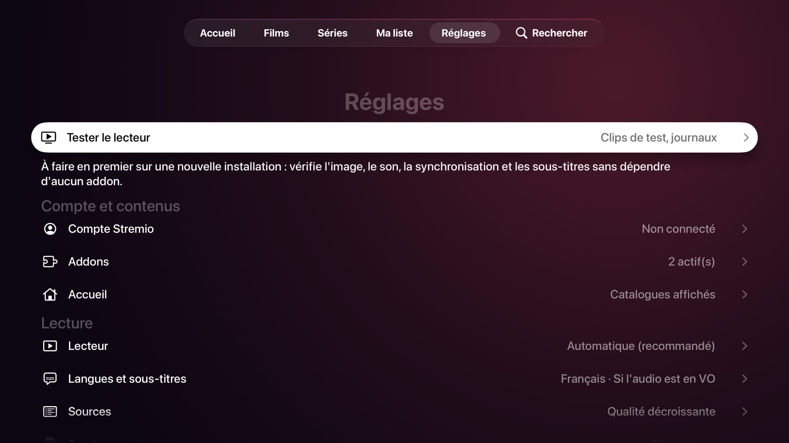

| Écran | Réglage | Effet |
|---|---|---|
| Tester le lecteur | clips de test, journaux | vérifie image, son, synchronisation et sous-titres sans addon |
| Compte Stremio | connexion par code ou e-mail, synchronisation, déconnexion | — |
| Addons | liste, ajout par adresse, ordre, actualisation | — |
| Accueil | catalogues affichés et leur ordre | — |
| Accueil | **Films déjà vus** : afficher / estomper / masquer | catalogues et recherche |
| Accueil | **Le bandeau défile tout seul** | rotation au repos |
| Lecteur | **Moteur** : automatique (AetherEngine) ou lecteur système | — |
| Lecteur | **Adapter l'écran au contenu** | fréquence et plage dynamique (avec le réglage tvOS du même nom) |
| Lecteur | **Mon téléviseur affiche le Dolby Vision** | à n'activer que si c'est vrai |
| Lecteur | **Saut gauche/droite** : 5 à 60 s | — |
| Lecteur | **Épisode suivant automatique**, **encart « Épisode suivant »** (30 s à 3 min avant la fin) | — |
| Apple TV | **Carrousel de l'écran d'accueil** : dernières sorties, continuer à regarder ou Ma liste | — |
| Assistance | **Sauvegarde** : sauvegarder les réglages sur le NAS, restaurer la dernière sauvegarde | réglages seulement (ni compte, ni addons, ni bibliothèque) ; 10 sauvegardes gardées |
| Lecteur | **« Êtes-vous toujours là ? »** : après 2, 3 (par défaut), 4 ou 5 épisodes enchaînés sans interaction, ou jamais | met en pause avant l'épisode suivant |
| Lecteur | **Son : mode nuit et dialogues** | renvoie aux réglages de l'Apple TV (Vidéo et audio) |
| Lecteur | **Bouton « Passer l'intro »**, **passer automatiquement** | minutages TheIntroDB / AniSkip |
| Lecteur | **Serveur de streaming** | adresse du serveur Stremio pour les torrents |
| Langues et sous-titres | langue audio préférée et secondaire, langue et activation des sous-titres, taille, position, fond | — |
| Sources | ordre de tri, langue préférée, privilégier les sources compatibles / déjà utilisées, masquer CAM/TS et non lisibles, lancer automatiquement la meilleure | — |
| Bandes-annonces | adresse du service du NAS, test de connexion, sur les fiches, dans le bandeau, délai | — |
| Diagnostics | journaux (affichage, envoi vers le NAS), stockage, vider les caches, état du Top Shelf, version | — |

## 12. Mettre à jour Aurora

1. Télécharger le nouvel IPA (Releases, `build-NN`).
2. **Sur l'Apple TV, ouvrir une autre app** (par exemple Réglages) : si le carrousel d'Aurora est
   affiché, l'installation reste bloquée.
3. Installer avec atvloadly, **le même compte Apple** que d'habitude, « Remove extensions »
   désactivé.
4. Ne pas supprimer Aurora avant : les réglages et la bibliothèque locale seraient perdus. Une
   installation par-dessus garde tout.

## 13. Dépannage

| Problème | Solution |
|---|---|
| atvloadly reste à « 100 % » | vérifier la version dans Réglages › À propos ; sinon ouvrir une autre app sur l'Apple TV et relancer |
| Le carrousel n'apparaît pas | ouvrir Aurora une fois, puis redémarrer l'Apple TV ; Aurora doit être dans la première rangée |
| Pas de bande-annonce | Réglages › Bandes-annonces › Tester la connexion ; si le service répond mais rien ne se charge, mettre à jour yt-dlp (changer `YTDLP_REFRESH` dans `compose.yaml` et reconstruire) |
| Une source ne démarre pas | essayer une autre source (panneau Sources du lecteur), ou « Réessayer avec AVPlayer » |
| Pas d'image, mais du son | écran « Aucune image » : la source n'est pas affichable ; en choisir une autre |
| Addon auto-hébergé sur le NAS : les sources s'affichent mais aucune ne démarre | derrière le proxy inversé HTTPS de DSM, l'addon peut renvoyer des liens de lecture en `http://` (port 80 fermé) : vérifier le début des `"url"` de `…/stream/movie/tt0111161.json` ; s'ils sont en `http://`, configurer l'adresse publique de l'addon (selon l'addon : variable `PUBLIC_URL`, en-tête `X-Forwarded-Proto`). En réseau local sans HTTPS, installer l'addon dans Aurora (Réglages › Addons) avec son adresse `http://192.168.…` : les apps Stremio officielles refusent ces adresses |
| Les torrents ne sont pas lisibles | configurer un serveur de streaming Stremio (Réglages › Lecteur) |
| Comprendre un problème | Réglages › Diagnostics › Afficher les journaux (ou les envoyer au récepteur du NAS, `scripts/log-receiver.py`) |
